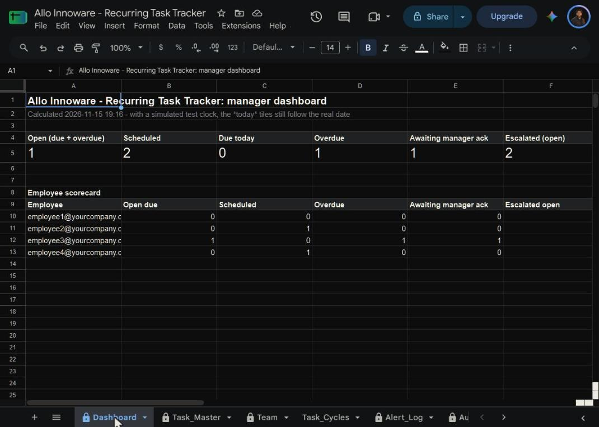
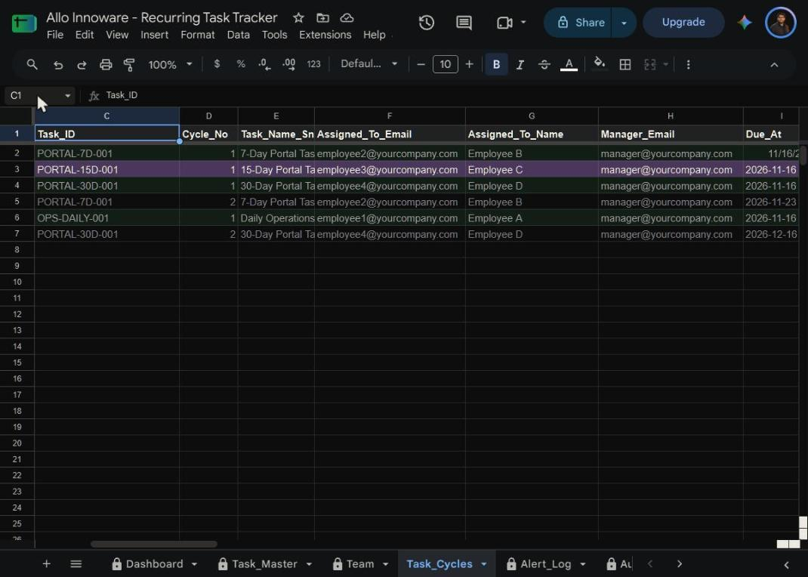
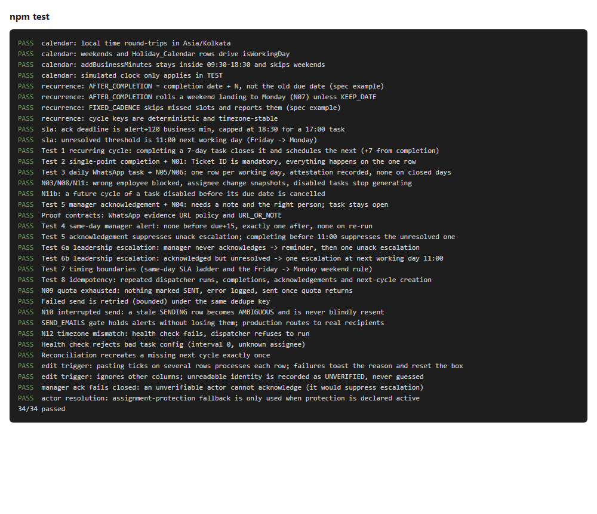

# Allo Innoware: Recurring Task Tracker

Google Sheets + Apps Script system that tracks recurring operational tasks (daily WhatsApp reports, 7/15/30-day portal tasks), records proof of completion, and alerts managers and leadership on a fixed SLA. The full specification is in [`docs/`](docs/README.md) (HLD, LLD, SLA rules, Apps Script design, test plan).

## Live Google Sheets prototype

**[Open the live Allo Innoware Task Tracker](https://docs.google.com/spreadsheets/d/1NHwzfoNeDtnCbbGegbYEe47Oxhpt9fIR9QEw4F0VRXY/edit)** (private; Editor access is granted to the evaluator on request. See [DEMO.md](DEMO.md) for the walkthrough).

It contains the nine generated tabs: Dashboard, Task_Master, Team, Task_Cycles, Alert_Log, Audit_Log, Holiday_Calendar, Settings, Error_Log. The workbook is built by `setupWorkbook()` from this repo, not assembled by hand.

## How it works

- `Task_Master` defines tasks. `Task_Cycles` is the single ledger: one row per occurrence, keyed deterministically (`Task|DAILY|date`, `Task|INTERVAL|date|time`) so nothing is ever created twice.
- Employees fill proof and tick **Submit_Complete**; managers write an action note and tick **Manager_Acknowledged**. An installable edit trigger validates, records who did it and when, and creates the next cycle.
- A 5-minute dispatcher moves cycles SCHEDULED -> DUE -> OVERDUE and sends: first manager alert (due + 15 min), one reminder (+60 business min), leadership escalation if unacknowledged (+120 business min, capped 18:30), and a next-working-day 11:00 escalation for acknowledged-but-open work. Every send is deduplicated by `Cycle_ID|Stage` in `Alert_Log`.
- Recurrence modes: `DAILY_WORKDAY`, `AFTER_COMPLETION` (completion date + N days), `FIXED_CADENCE` (fixed grid, missed slots skipped).
- Safety: TEST/PRODUCTION switch, `SEND_EMAILS` gate, simulated clock, all test mail routed to one inbox.

## Layout

```
src/            Apps Script (V8) source, pushed with clasp
  00-07         constants, utils, time/calendar, store seam, config, audit, recurrence, cycles
  08-11         completion + acknowledgement, SLA rules, notifications, dispatcher
  13-16         seed data, health check, edit trigger + menu, workbook setup
  9x_Tests_*    self-tests (run in Node and from the sheet menu)
tests/run.js    Node runner (vm sandbox, strict non-reentrant lock mock)
docs/           specification pack
```

All business logic talks to an in-memory store in tests and to the real sheets through the same `tbl(name)` interface in production.

## Test

```bash
npm test
```

34 tests: the 8 assignment scenarios (daily completion, 7/15/30-day cadences, WhatsApp attestation, manager acknowledgement, both escalation paths, timing boundaries incl. Friday -> Monday, idempotency) plus failure cases (duplicate triggers, bad proof, wrong person, mail quota, interrupted send, timezone mismatch, missing next cycle). CI runs the same command.

## Live run (screenshots)

Taken from the [live spreadsheet](https://docs.google.com/spreadsheets/d/1NHwzfoNeDtnCbbGegbYEe47Oxhpt9fIR9QEw4F0VRXY/edit) with sample data, `ENVIRONMENT=TEST`, the simulated clock at Mon 2026-11-16 18:31, and all mail routed to one test inbox. What was exercised through the real edit trigger and the 5-minute dispatcher:

| Check | Result |
|---|---|
| 7-day portal task completed with a ticket ID | `COMPLETED`, actor and time stamped, cycle 2 created due 2026-11-23 17:00 |
| Submit ticked with no ticket ID | rejected, toast "Enter the portal Ticket ID...", box reset |
| Daily task completed with a WhatsApp attestation | `COMPLETED` |
| 30-day task completed after leadership escalation | `COMPLETED`, next cycle due 2026-12-16 |
| Overdue cycles at 18:31 | manager first alert + leadership escalation sent for each, `[TEST]` subject |
| Manager note + `Manager_Acknowledged` | ack time, email and source recorded; task stays open |
| Dispatcher left running ~26 h (~300 ticks) | still 6 alert rows: no duplicate sends, no duplicate cycles |






## Engine preview

These are **engine previews, not Google Sheets screenshots**. They are rendered from this repo's real code with the in-memory store and the TEST clock; regenerate with `node scripts/preview.js <dir>`.

A simulated day (clock 18:31). Portal Task A was completed with a ticket ID and its next cycle was scheduled +7 days. Daily Operations Update was acknowledged by the manager, so it is not escalated. Portal Tasks B and C were never acknowledged, so they got a first alert, a reminder and a leadership escalation:




## Deploy

Needs Node 18+, a Google account, and the Apps Script API enabled at <https://script.google.com/home/usersettings>.

```bash
npm i -g @google/clasp
clasp login
clasp create --type sheets --title "Allo Innoware Task Tracker" --rootDir src
clasp push
```

Then open the new spreadsheet and use the **Tasks** menu in this order:

1. **Set up workbook (first run)**: creates tabs, validation, dashboard, protections, filter views, and seeds example data (`example.com` team, five tasks).
2. Replace seed addresses in `Team` and `Task_Master`; set `TEST_RECIPIENT_EMAIL` and `SEND_EMAILS=TRUE` in `Settings`.
3. **Create Initial Cycles**, then **Run Health Check** (must be clean).
4. **Install/Repair Triggers**, signed in as the operations-owned account (the owner of the triggers sends the mail).
5. Demo: **Set Test Clock** to walk through due -> overdue -> reminder -> escalation without waiting.
6. Go live: `ENVIRONMENT=PRODUCTION`, clear `TEST_NOW_OVERRIDE`, review warnings, re-run the health check.

## Deviations from the spec

- The dispatcher also runs the idempotent initial-cycle creation, so a newly added interval task just works.
- Leadership recipients are derived from active `LEADERSHIP` members in `Team`; there is no separate `LEADERSHIP_EMAILS` setting.
- Extra settings: `WHATSAPP_EVIDENCE_URL_REQUIRED`, `ROW_PROTECTION_ACTIVE`.
- OVERDUE starts at due + grace (`>=`). Reminder and ack timing use the current `Task_Master` parameters.
- Filter view titles use an ASCII hyphen. The dashboard uses the real `TODAY()`, not the simulated clock.
- Manager acknowledgement **fails closed** when the actor cannot be identified (an unverified ack would suppress escalation). Employee completion with an unreadable identity is accepted and recorded as `UNVERIFIED` with a blank email, as the spec allows.
- Unacknowledged and unresolved escalations are independent and can both fire for one cycle.

## Known limits and what was not verified

- **Live run covered one account only.** Setup, the edit trigger, the dispatcher, alerts and dedupe were checked in the live sheet (above), all as the owner/admin account. Employee and manager actions from *other* accounts, and per-row protections, are not yet verified.
- In the live run the owner's `e.user` was readable on consumer Gmail (`EVENT_USER`). For other consumer Gmail users `e.user` is often blank, so completions record `UNVERIFIED` and manager acknowledgements are refused.
- On a consumer (non-Workspace) spreadsheet `setDomainEdit` throws; setup now tolerates it so the remaining protections still apply.
- Toggling a checkbox with the keyboard did not fire the installable edit trigger in the live run; a mouse click did. Untick and re-tick if a box stays ticked with nothing recorded. Use Google Workspace accounts, or set `ROW_PROTECTION_ACTIVE=TRUE` only after confirming per-row protections work, which enables the assignment-based fallback identity for employee completions only. Manager acknowledgements never use the fallback.
- Employees can edit proof after completion (audit trail records the completion, not later edits).
- Apps Script email quota (100/day consumer, 1,500 Workspace) bounds alert volume; quota failures are logged and retried.
