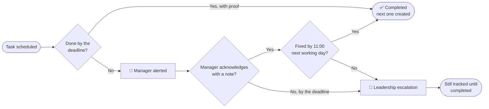
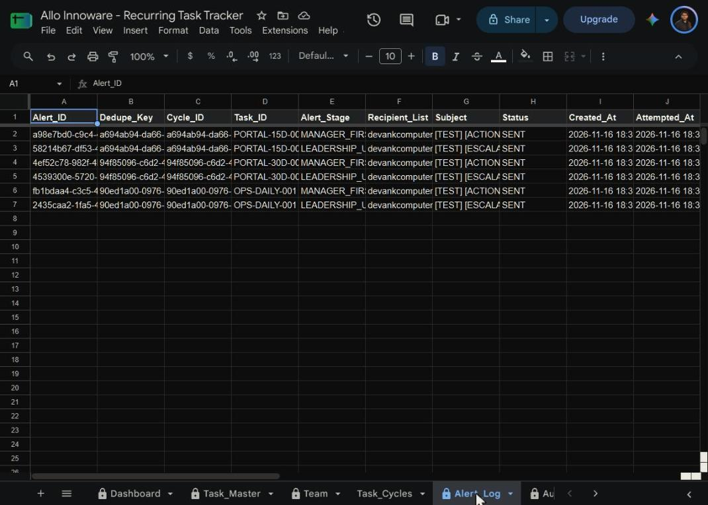
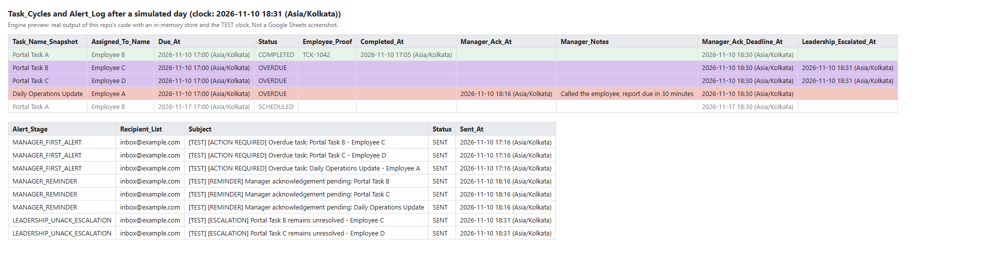

<div align="center">

# Allo Innoware · Recurring Task Tracker

**A Google Sheet that keeps track of recurring work, asks for proof when it is done, and alerts the right people when it is not.**

[](https://docs.google.com/spreadsheets/d/1NHwzfoNeDtnCbbGegbYEe47Oxhpt9fIR9QEw4F0VRXY/edit)
[](DEMO.md)

[](https://github.com/DevankS5/allo-innoware-task-tracker/actions/workflows/test.yml)


</div>

> [!NOTE]
> The live sheet is private. Editor access is granted to the evaluator on request. It runs in **TEST mode**: the clock is simulated and every email goes to one test inbox, so nothing reaches real people.

---

## In plain words

**The problem.** A small team has jobs that repeat: a daily WhatsApp operations update, and portal tasks every 7, 15 and 30 days. Today nobody can see at a glance what was done, who did it, or what slipped, and a missed task is noticed late.

**What this does.** Every task lives in one Google Sheet. The sheet creates each new occurrence by itself, asks the employee for proof when they mark it done, and emails the manager if the deadline passes. If the manager does not respond in time, it emails leadership. Every step is time-stamped and logged.

| Who | What they do in the sheet | What the system does for them |
|---|---|---|
| 👩‍💼 **Employee** | Types the proof (ticket ID or WhatsApp reference) and ticks **Submit_Complete** | Checks the proof, records who and when, and schedules the next occurrence |
| 🧑‍💼 **Manager** | Writes a short action note and ticks **Manager_Acknowledged** | Sends an alert when a task is late, one reminder, and records the acknowledgement |
| 🏢 **Leadership** | Nothing; they only receive emails | Gets an escalation email when a manager does not act in time |

No new software to install: it is a normal Google Sheet with a script attached.

## A task's life, step by step



**Example: a task due at 17:00 on a working day**

| Time | What happens |
|---|---|
| **17:00** | Deadline. If the employee has submitted proof, the task closes and the next one is created. |
| **17:15** | Still open → first email to the manager (15-minute grace). |
| **18:15** | Still not acknowledged → one reminder to the manager. |
| **18:30** | Still not acknowledged at close of business → escalation email to leadership. |
| **11:00 next working day** | Acknowledged but still not done → escalation email to leadership. |

Weekends and the dates in `Holiday_Calendar` are skipped. Every email is sent **once only**: the sheet keeps a log and never repeats an alert, even if the script runs hundreds of times.

## What is inside the sheet

| Tab | What it is for | Who uses it |
|---|---|---|
| **Dashboard** | Counts of open, overdue, unacknowledged and escalated work | Managers, leadership |
| **Task_Cycles** | The main list: one row per task occurrence, where work is submitted and acknowledged | Everyone |
| **Task_Master** | The list of recurring tasks: who, how often, due time, proof needed | Admin |
| **Team** | Names, emails and roles | Admin |
| **Alert_Log** | Every email sent, so nothing is sent twice | Read-only |
| **Audit_Log** | Every action, with who and when | Read-only |
| **Holiday_Calendar** | Days off, so deadlines skip them | Admin |
| **Settings** | Work hours, test mode, email switch | Admin |
| **Error_Log** | Anything that went wrong, with a "resolved" column | Admin |

The workbook is built by the code in this repo (`setupWorkbook()`), not by hand.

## Proof it works

These screenshots are from the [live sheet](https://docs.google.com/spreadsheets/d/1NHwzfoNeDtnCbbGegbYEe47Oxhpt9fIR9QEw4F0VRXY/edit), run with sample data, a simulated clock at Mon 16 Nov 2026, 18:31, and all mail sent to one test inbox.

| What was tried | What happened |
|---|---|
| 7-day portal task completed with a ticket ID | ✅ Closed, name and time recorded, next one due 23 Nov 17:00 |
| Submit ticked **without** a ticket ID | ✅ Refused with a message; the tick was undone |
| Daily task completed with a WhatsApp reference | ✅ Closed |
| 30-day task completed after leadership had been alerted | ✅ Closed, next one due 16 Dec |
| Tasks still open at 18:31 | ✅ Manager alert and leadership escalation sent for each |
| Manager wrote a note and ticked acknowledge | ✅ Time and name recorded; task stays open until done |
| Left running for about 26 hours (~300 checks) | ✅ Still 6 emails in total: no duplicates |

<table>
<tr>
<td width="50%"><b>Manager dashboard</b><br/></td>
<td width="50%"><b>Alert log: one row per email</b><br/></td>
</tr>
<tr>
<td colspan="2"><b>Task_Cycles: the main ledger</b><br/></td>
</tr>
</table>

The same logic is covered by **34 automated tests** that run on every change (see the green *tests* badge above).

---

## For engineers

<details open>
<summary><b>How the engine works</b></summary>

- `Task_Cycles` is the single ledger: one row per occurrence, keyed deterministically (`Task|DAILY|date`, `Task|INTERVAL|date|time`), so a cycle is never created twice.
- An installable edit trigger handles **Submit_Complete** and **Manager_Acknowledged**: it validates, records actor and time, and creates the next cycle.
- A 5-minute time-driven dispatcher moves cycles `SCHEDULED → DUE → OVERDUE` and sends alerts. Every send is deduplicated by `Cycle_ID|Stage` in `Alert_Log`.
- Recurrence modes: `DAILY_WORKDAY`, `AFTER_COMPLETION` (completion date + N days), `FIXED_CADENCE` (fixed grid, missed slots skipped).
- Safety: TEST/PRODUCTION switch, `SEND_EMAILS` gate, simulated clock, all test mail routed to one inbox. A health check blocks the dispatcher if a sheet header is wrong.

</details>

<details>
<summary><b>Code layout</b></summary>

```
src/            Apps Script (V8) source, pushed with clasp
  00-07         constants, utils, time/calendar, store seam, config, audit, recurrence, cycles
  08-11         completion + acknowledgement, SLA rules, notifications, dispatcher
  13-16         seed data, health check, edit trigger + menu, workbook setup
  9x_Tests_*    self-tests (run in Node and from the sheet menu)
tests/run.js    Node runner (vm sandbox, strict non-reentrant lock mock)
scripts/        preview renderer
docs/           specification pack (HLD, LLD, SLA, test plan, deployment)
```

All business logic talks to an in-memory store in tests and to the real sheets through the same `tbl(name)` interface in production.

</details>

<details>
<summary><b>Run the tests</b></summary>

```bash
npm test
```

34 tests: the 8 assignment scenarios (daily completion, 7/15/30-day cadences, WhatsApp attestation, manager acknowledgement, both escalation paths, timing boundaries incl. Friday → Monday, idempotency) plus failure cases (duplicate triggers, bad proof, wrong person, mail quota, interrupted send, timezone mismatch, missing next cycle). CI runs the same command.

Engine previews rendered from the real code with the in-memory store (not Google Sheets screenshots; regenerate with `node scripts/preview.js <dir>`):




</details>

<details>
<summary><b>Deploy your own copy</b></summary>

Needs Node 18+, a Google account, and the Apps Script API enabled at <https://script.google.com/home/usersettings>.

```bash
npm i -g @google/clasp
clasp login
clasp create --type sheets --title "Allo Innoware Task Tracker" --rootDir src
clasp push
```

`clasp create` writes a default `src/appsscript.json`; restore the repo's version (`git checkout -- src/appsscript.json`) before `clasp push`, or the timezone and scopes are lost.

Then open the spreadsheet and use the **Tasks** menu in this order:

1. **Set up workbook (first run)**: creates tabs, validation, dashboard, protections, filter views, and seeds example data (`example.com` team, five tasks).
2. Replace seed addresses in `Team` and `Task_Master`; set `TEST_RECIPIENT_EMAIL` and `SEND_EMAILS=TRUE` in `Settings`.
3. **Create Initial Cycles**, then **Run Health Check** (must be clean).
4. **Install/Repair Triggers**, signed in as the operations-owned account (the trigger owner sends the mail).
5. Demo: **Set Test Clock** to walk through due → overdue → reminder → escalation without waiting.
6. Go live: `ENVIRONMENT=PRODUCTION`, clear `TEST_NOW_OVERRIDE`, review warnings, re-run the health check.

</details>

<details>
<summary><b>Deviations from the spec</b></summary>

- The dispatcher also runs the idempotent initial-cycle creation, so a newly added interval task just works.
- Leadership recipients are derived from active `LEADERSHIP` members in `Team`; there is no separate `LEADERSHIP_EMAILS` setting.
- Extra settings: `WHATSAPP_EVIDENCE_URL_REQUIRED`, `ROW_PROTECTION_ACTIVE`.
- OVERDUE starts at due + grace (`>=`). Reminder and ack timing use the current `Task_Master` parameters.
- Filter view titles use an ASCII hyphen. The dashboard uses the real `TODAY()`, not the simulated clock.
- Manager acknowledgement **fails closed** when the actor cannot be identified (an unverified ack would suppress escalation). Employee completion with an unreadable identity is accepted and recorded as `UNVERIFIED` with a blank email, as the spec allows.
- Unacknowledged and unresolved escalations are independent and can both fire for one cycle.

</details>

## Known limits and what was not verified

- **Live run covered one account only.** Setup, the edit trigger, the dispatcher, alerts and dedupe were checked in the live sheet, all as the owner/admin account. Employee and manager actions from *other* accounts, and per-row protections, are not yet verified.
- In the live run the owner's `e.user` was readable on consumer Gmail (`EVENT_USER`). For other consumer Gmail users `e.user` is often blank, so completions record `UNVERIFIED` and manager acknowledgements are refused. Google Workspace accounts avoid this.
- On a consumer (non-Workspace) spreadsheet `setDomainEdit` throws; setup tolerates it so the remaining protections still apply.
- Ticking a checkbox with the keyboard did not fire the installable edit trigger in the live run; a mouse click did. Untick and re-tick if a box stays ticked with nothing recorded (the dispatcher logs a warning for this case).
- `ROW_PROTECTION_ACTIVE=TRUE` enables an assignment-based fallback identity for employee completions only, and only after per-row protections are confirmed to work. Manager acknowledgements never use the fallback.
- WhatsApp proof is an employee attestation, not independent verification.
- Employees can edit proof after completion (the audit trail records the completion, not later edits).
- Apps Script email quota (100/day consumer, 1,500 Workspace) bounds alert volume; quota failures are logged and retried.

## Documentation

| Read this | If you want |
|---|---|
| [DEMO.md](DEMO.md) | A 5-minute guided tour of the live sheet |
| [docs/README.md](docs/README.md) | The specification pack overview and reading order |
| [01 HLD](docs/01-HLD.md) · [02 LLD](docs/02-LLD.md) | Architecture and sheet/column design |
| [03 Recurrence & SLA](docs/03-RECURRENCE-SLA.md) | Exact timing and escalation rules |
| [05 Test plan](docs/05-TEST-PLAN.md) | Test scenarios and evidence |
| [06 Deployment](docs/06-IMPLEMENTATION-DEPLOYMENT.md) · [07 Security](docs/07-SECURITY-OPERATIONS.md) | Rollout, permissions, operations |
