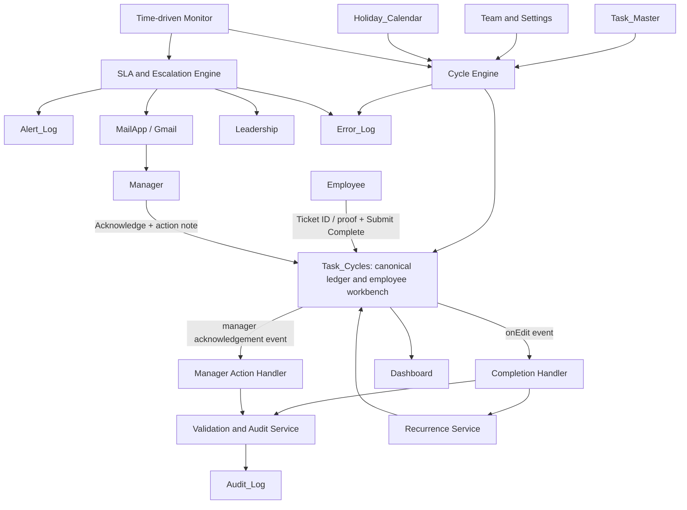

# 01 — High-Level Design (HLD)

## 1. Document control

| Attribute | Value |
|---|---|
| System | Allo Innoware Recurring Task Tracking & Escalation Automation |
| Design level | High-Level Design |
| Platform | Google Sheets + Google Apps Script + Gmail/MailApp |
| Intended scale | 3–4 employees initially; expandable to a small operations team |
| Primary interface | Google Sheets |
| Default timezone | `Asia/Kolkata` |
| Version | 1.0 — proposed design |

## 2. Executive summary

The system converts recurring operational obligations into explicit, timestamped task cycles. The recurring task definition is stored separately from each occurrence. Employees use one sheet (`Task_Cycles`) to see their open work and submit a completion reference. Managers use a dashboard and the same underlying cycle records to see overdue work and acknowledge alerts. Apps Script handles the lifecycle and notifications.

The architecture deliberately avoids a design in which employees enter a Ticket ID in one report and then re-enter it in a central tracker. The `Task_Cycles` sheet is both the operational workbench and the cycle ledger. Every recurrence is a separate row with a unique `cycle_id` and `cycle_key`.

The system is not intended to replace a ticketing system or WhatsApp. It records the operational task and its evidence/reference, and it automates reminders and escalation around that record.

## 3. Business goals

1. Maintain a configurable master list of recurring tasks, owners, due rules, and proof requirements.
2. Automatically create the next task occurrence without requiring employees to calculate due dates.
3. Give each employee a clear view of tasks requiring action.
4. Capture completion, proof, actor, and timestamp once.
5. Provide the manager with a consolidated view of pending and overdue items.
6. Require explicit manager acknowledgement and capture the acknowledgement event.
7. Escalate unresolved items to leadership according to an agreed SLA.
8. Make the automation safe to rerun through idempotency controls and audit logs.

## 4. Non-goals for the first release

- Replacing the external portal or generating portal tickets automatically.
- Automatically reading private WhatsApp group history or independently verifying every post.
- Providing strict row-level confidentiality inside one shared Google Sheets workbook.
- Building a general-purpose workflow engine for arbitrary approval chains.
- Guaranteeing real-time, second-level notification delivery. Apps Script time triggers are best-effort scheduled executions, not a hard real-time scheduler.
- Supporting complex recurrence expressions such as “last business day of every month” in v1. The first release supports daily working-day and N-day interval schedules.

## 5. Stakeholders and roles

| Role | Responsibilities | System permissions |
|---|---|---|
| Employee | View assigned cycles, enter Ticket ID/proof, submit completion | Edit only employee-input fields for assigned cycle rows where range protection is configured |
| Manager | Monitor team, acknowledge alerts, add follow-up notes | View team data; edit manager acknowledgement fields |
| Leadership | Review escalations and direct resolution | Dashboard and escalation visibility; optional read-only workbook access |
| System administrator | Configure tasks, team, SLA values, holidays, and triggers | Full workbook and script administration |
| Automation owner | Own Apps Script triggers and outbound notifications | Designated operations account; not an individual employee's personal account |

## 6. Proposed architecture

### 6.1 Logical layers

| Layer | Components | Responsibility |
|---|---|---|
| Configuration | `Task_Master`, `Team`, `Settings`, `Holiday_Calendar` | Defines the rules and recipients |
| Operating data | `Task_Cycles` | Holds each task occurrence, proof inputs, completion, and manager acknowledgement |
| Application logic | Apps Script services | Cycle creation, validation, state transitions, SLA calculations, and reconciliation |
| Notification | `Alert_Log`, `MailApp` | Sends and deduplicates manager and leadership notifications |
| Reporting | `Dashboard` | Aggregates operational status for the manager |
| Governance | `Audit_Log`, `Error_Log` | Records important actions and system failures |

## 7. Core design principles

### 7.1 One source of truth

`Task_Cycles` is the canonical record for each occurrence. Employee workbench views, manager dashboard metrics, and escalation processing all read the same row. Do not create a second editable employee report that must be synchronized with a master tracker.

### 7.2 Separate task definition from task occurrence

`Task_Master` stores durable configuration, while `Task_Cycles` stores individual occurrences. For example, `PORTAL-7D-001` is one recurring task definition, while each weekly occurrence has a different `cycle_id`.

### 7.3 Append new cycles; do not overwrite history

A completed cycle row is retained. The next occurrence receives a new row, cycle ID, due date, and proof field. This supports audit, historical performance reporting, and no-loss reconciliation.

### 7.4 Use configuration rather than hard-coded task rules

Frequency, due time, proof type, assignee, manager, and SLA values should be stored in the master/configuration tabs. Apps Script should interpret configuration rather than contain task-specific `if` statements for Employee A/B/C/D.

### 7.5 Treat completion as a state transition

A Ticket ID or proof string by itself does not close a task. The employee supplies the proof and explicitly submits completion. The script validates the proof, stamps the completion, changes state, and creates the next interval cycle.

### 7.6 Design for retries

Time-based automation may be run repeatedly. Every cycle and alert must have a deterministic idempotency key. Every handler must be safe when the same event is processed twice.

## 8. Primary user journeys

### 8.1 Employee completion — portal task

1. Employee opens the workbook and selects the saved filter view for their email address.
2. The employee locates the open row for the portal task.
3. The employee enters the Ticket ID in `Employee_Proof`.
4. The employee optionally enters a portal URL or evidence reference in `Evidence_URL`.
5. The employee checks `Submit_Complete`.
6. The completion handler verifies that the cycle is open and that a Ticket ID is present.
7. The script records `Completed_At`, `Completed_By_Email`, and the identity source, sets `Status=COMPLETED`, and adds an audit event.
8. For an interval task, the script calculates and inserts the next scheduled cycle.
9. The new cycle is visible in the ledger with a future due date; the completed row remains as history.

### 8.2 Employee completion — daily WhatsApp update

1. The daily row is created for each working day.
2. Employee shares the operational update in the designated WhatsApp group.
3. Employee enters a short proof reference such as `Posted 16:42 — daily operations summary` and, where required, a Drive screenshot URL.
4. Employee checks `Submit_Complete`.
5. The script validates the configured WhatsApp proof fields and records a timestamped attestation.
6. The next working day's cycle is created by the daily cycle generator, not by adding one day to the completion time.

The system records the employee's attestation. Without an approved messaging integration, it does not independently inspect the WhatsApp group.

### 8.3 Manager response

1. Manager receives the overdue-task email with employee, task, due time, proof requirement, and workbook link.
2. Manager opens the `Manager Pending` filter view or dashboard drill-down.
3. Manager checks `Manager_Acknowledged` and adds a concise `Manager_Notes` action.
4. Script records acknowledgement time and actor, and writes an audit event.
5. If the task is completed before the resolution SLA, leadership escalation is suppressed.
6. If it remains open beyond the resolution threshold, leadership receives one escalation.

### 8.4 Leadership escalation

Leadership email contains the task, owner, original due time, elapsed overdue duration, proof status, manager acknowledgement status, manager notes, prior notification timestamps, and a direct workbook link.

## 9. Component responsibilities

| Component | Responsibility | Must not do |
|---|---|---|
| `Task_Master` | Define task cadence, proof, recipient, and policy | Store individual completion events |
| `Task_Cycles` | Store one row per occurrence and serve as the employee input point | Require duplicate submission elsewhere |
| `CycleService` | Create initial and next cycles | Send email directly |
| `RecurrenceService` | Calculate next due dates and business-day adjustments | Change a completed historical row's due date |
| `CompletionService` | Validate and close an occurrence | Trust arbitrary text without proof-type validation |
| `ManagerActionService` | Record acknowledgement and notes | Mark the underlying task completed |
| `SlaService` | Determine alert/reminder/escalation eligibility | Send duplicate alerts on each monitor run |
| `NotificationService` | Send emails and write alert outcomes | Decide business recurrence rules |
| `DashboardService` | Aggregate current state | Become a second source of truth |
| `AuditService` | Append lifecycle events | Mutate task-cycle state |
| `ReconciliationService` | Repair incomplete internal transitions safely | Blindly resend ambiguous emails |

## 10. Recurrence model

The design supports two interval modes:

- `AFTER_COMPLETION` — next due date is based on the completion date plus the configured interval. This is the default for the assignment because it avoids immediately creating an already-overdue follow-on cycle when the current one was completed late.
- `FIXED_CADENCE` — due dates stay anchored to the original schedule. If a cycle is completed after one or more scheduled dates, missed slots are skipped and the next future occurrence is created. The system does not create a backlog of multiple simultaneous open cycles for one task.

Daily tasks use `DAILY_WORKDAY`: one row per working date. This rule is independent of the completion time.

For exact calculation and examples, see `03-RECURRENCE-SLA.md`.

## 11. Manager and leadership SLA model

Proposed defaults:

- Task deadline: configurable per task; default 17:00 local time.
- First manager alert: 15 minutes after the deadline.
- Manager acknowledgement: within 120 business minutes from first alert, capped at the same day's 18:30 close.
- One manager reminder: after 60 business minutes if no acknowledgement has been captured and the acknowledgement deadline has not passed.
- Escalation for missing manager acknowledgement: at the acknowledgement deadline.
- Escalation for an acknowledged but still-open task: next working day at 11:00.

The due time should be configured no later than 17:00 for the default same-day alert/acknowledgement policy to work predictably. Task-specific overrides are allowed, but a later due time requires a reviewed SLA.

## 12. Notification strategy

| Event | Recipient | Channel | Dedupe key |
|---|---|---|---|
| Manager overdue alert | Task's manager | Email | `cycle_id|MANAGER_FIRST_ALERT` |
| Manager reminder | Task's manager | Email | `cycle_id|MANAGER_REMINDER` |
| Leadership — no manager acknowledgement | Leadership list + manager | Email | `cycle_id|LEADERSHIP_UNACK_ESCALATION` |
| Leadership — task unresolved after acknowledgement | Leadership list + manager | Email | `cycle_id|LEADERSHIP_UNRESOLVED_ESCALATION` |

Each notification is recorded in `Alert_Log`. Successful notification stages are never sent again for the same cycle. A `SENDING` record left by an interrupted execution is treated as ambiguous and is not blindly resent; an administrator reviews it or the reconciliation routine verifies the unique email token before retrying.

## 13. Non-functional requirements

| Area | Requirement | Proposed implementation |
|---|---|---|
| Correctness | No duplicate cycle creation | Deterministic `cycle_key`, script lock, and existence check |
| Correctness | No duplicate completed-cycle processing | Check cycle status and completion fields before transition |
| Correctness | No repeated successful alert | Unique alert dedupe key in `Alert_Log` |
| Auditability | Track who/when/proof for completion | Completion columns plus `Audit_Log` |
| Auditability | Track manager review | Manager acknowledgement columns plus audit event |
| Usability | One employee operating location | `Task_Cycles` with saved employee filter views |
| Usability | Minimal data entry | Ticket ID or one proof reference + one submit checkbox |
| Availability | Continue after transient failures | Monitor retries and reconciliation, with error log |
| Performance | Efficient for small team | Batch reads/writes; avoid per-cell loops |
| Security | Restrict system and manager columns | Protected ranges; designated operations owner |
| Privacy | No unsupported confidentiality claims | State that filter views are not access controls |
| Maintainability | Rules are configurable | Master/configuration tables and named constants |

## 14. Platform constraints and design implications

1. **Installable trigger ownership:** installable Apps Script triggers run under the account that created them. The automation should be installed by a designated operations account, not an employee likely to leave. Email will be sent under that account's authorization.
2. **User identity:** `Session.getActiveUser().getEmail()` can be blank in some execution contexts. The actual Workspace domain and trigger/UI context must be tested. Do not assume an installable time trigger can identify the employee who edited a cell.
3. **Trigger timing:** time-driven Apps Script triggers are not hard real-time; Google documents that trigger execution time can be slightly randomized. A 5-minute dispatcher is appropriate for a prototype, but the SLA should be interpreted as automated detection within the polling interval, not a second-exact deadline.
4. **Quotas:** Apps Script has runtime, trigger, and email-recipient quotas. Keep the workflow small, batch operations, monitor quota, and review current limits before production.
5. **Sheet sharing:** a filter view changes what a user sees, not what they are authorized to access. Protected ranges prevent unauthorised edits but do not provide row confidentiality.

## 15. Risks and mitigations

| Risk | Impact | Mitigation |
|---|---|---|
| Employee completes task but omits Ticket ID | False completion | Proof-specific validation blocks submission |
| Daily WhatsApp update is attested but not actually posted | Weak evidence | Require a screenshot/link for audit-sensitive tasks; be explicit that checkbox is self-attestation |
| Apps Script cannot retrieve active user's email | Incorrect/blank actor attribution | Use same-domain Workspace; test identity; use protected per-row edit permissions; record identity source |
| Trigger owner leaves company | Automation stops or emails from wrong account | Designated operations-owned account and documented handover |
| Time trigger runs late | SLA notification delay | 5-minute dispatcher; define operational latency; use Cloud Scheduler for hard timing needs |
| Email send outcome is ambiguous | Duplicate or missing email risk | Alert state machine, unique token, no blind retry of ambiguous `SENDING` records |
| Users sort or delete ledger rows | Misaligned updates/audit gaps | Protect system ranges, discourage manual sorting, use filter views, reference cycles by ID rather than row number |
| Task definition is edited mid-cycle | Historical meaning changes | Snapshot name, assignee, proof type, and recurrence mode into each cycle row |
| Shared sheet reveals all tasks | Confidentiality issue | Separate files or role-aware front end if row-level privacy is required |

## 16. Architecture acceptance criteria

The HLD is accepted when the business owner agrees on:

- completion-based vs fixed-cadence recurrence per task;
- working days, holidays, task cutoff times, and work window;
- manager acknowledgement and leadership escalation thresholds;
- accepted evidence for the WhatsApp daily task;
- whether all employees may view each other's operational records;
- which account owns the automation and outbound email;
- manager and leadership email recipients.

