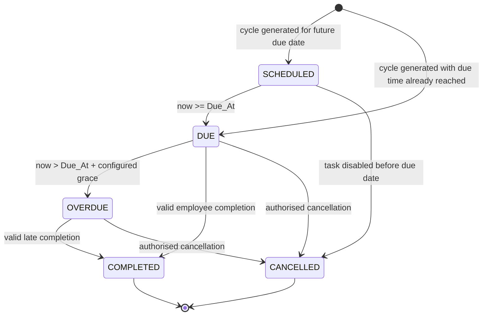

# 02 — Low-Level Design (LLD)

## 1. Purpose

This document specifies the exact spreadsheet tables, field names, data types, validations, state transitions, formulas, unique keys, and Apps Script service contracts required to implement the system.

All dates/times are interpreted in the spreadsheet timezone configured as `Asia/Kolkata`, unless the business owner changes the setting.

## 2. Workbook layout

Create these tabs with exact names:

1. `Dashboard`
2. `Task_Master`
3. `Team`
4. `Task_Cycles`
5. `Alert_Log`
6. `Audit_Log`
7. `Holiday_Calendar`
8. `Settings`
9. `Error_Log`

Do not rename tabs after trigger deployment without changing the constants in Apps Script.

---

## 3. `Task_Master` schema

One row per recurring task definition. The `Task_ID` is immutable once cycles exist.

| Column | Field | Type | Required | Example / accepted values | Description |
|---|---|---|---|---|---|
| A | `Task_ID` | Text | Yes | `PORTAL-7D-001` | Unique stable ID |
| B | `Is_Active` | Boolean | Yes | `TRUE` | Whether new cycles should be generated |
| C | `Task_Name` | Text | Yes | `Portal Task A` | Human-readable title |
| D | `Task_Description` | Text | No | `Complete portal task and update ticket` | Work instructions |
| E | `Assigned_To_Email` | Email | Yes | `employeeb@company.com` | Employee identity and notification routing |
| F | `Manager_Email` | Email | Yes | `manager@company.com` | Manager responsible for acknowledgement |
| G | `Frequency_Type` | Enum | Yes | `DAILY`, `INTERVAL` | Daily working-day vs N-day recurrence |
| H | `Interval_Days` | Integer | Conditional | `7`, `15`, `30`; blank for daily | Interval in calendar days |
| I | `Recurrence_Mode` | Enum | Yes | `DAILY_WORKDAY`, `AFTER_COMPLETION`, `FIXED_CADENCE` | Cycle-generation strategy |
| J | `Initial_Due_At` | Datetime | Yes | `2026-11-10 17:00` | First occurrence due time |
| K | `Due_Time` | Time | Yes | `17:00` | Local due time applied to future occurrences |
| L | `Working_Days_Only` | Boolean | Yes | `TRUE` | Whether dates should avoid non-working days |
| M | `Non_Working_Day_Policy` | Enum | Yes | `NEXT_WORKING_DAY`, `KEEP_DATE` | How interval due dates landing on weekends/holidays are handled |
| N | `Priority` | Enum | Yes | `LOW`, `NORMAL`, `HIGH`, `CRITICAL` | Alert/dashboard priority |
| O | `Required_Proof_Type` | Enum | Yes | `TICKET_ID`, `WHATSAPP_ATTESTATION`, `URL_OR_NOTE`, `NONE` | Validation contract for completion |
| P | `Proof_Required` | Boolean | Yes | `TRUE` | Whether proof field must be non-empty |
| Q | `Completion_Instructions` | Text | No | `Enter portal Ticket ID` | Employee-facing instructions |
| R | `First_Manager_Alert_Minutes` | Integer | Yes | `15` | Grace after due time before first manager alert |
| S | `Manager_Ack_SLA_Business_Minutes` | Integer | Yes | `120` | Business minutes allowed for manager acknowledgement |
| T | `Manager_Reminder_Offset_Minutes` | Integer | Yes | `60` | One reminder after this many business minutes |
| U | `Escalate_If_Manager_Unacknowledged` | Boolean | Yes | `TRUE` | Enable manager-ack escalation |
| V | `Escalate_If_Task_Unresolved` | Boolean | Yes | `TRUE` | Enable unresolved-work escalation |
| W | `Task_Owner_Email` | Email | No | `opsadmin@company.com` | Configuration owner |
| X | `Created_At` | Datetime | System | Timestamp | Script-owned |
| Y | `Updated_At` | Datetime | System | Timestamp | Script-owned |
| Z | `Task_Version` | Integer | System | `1` | Increment when material configuration changes |

### Validation rules

- `Task_ID` must be unique and non-empty.
- `Frequency_Type=DAILY` requires `Recurrence_Mode=DAILY_WORKDAY` and a blank `Interval_Days` or `1`.
- `Frequency_Type=INTERVAL` requires integer `Interval_Days >= 1` and mode `AFTER_COMPLETION` or `FIXED_CADENCE`.
- `Required_Proof_Type=TICKET_ID` requires `Proof_Required=TRUE`.
- A due time later than 17:00 requires an explicit SLA override review; the default SLA assumes task cutoff no later than 17:00.
- Assigned employee and manager emails must exist in `Team` and be active.

### Snapshot rule

At cycle creation, copy the task name, assignee, manager, proof type, priority, recurrence mode, interval, and task version into `Task_Cycles`. Historical rows must not silently change when the master is edited later.

---

## 4. `Team` schema

| Column | Field | Type | Required | Description |
|---|---|---|---|---|
| A | `Member_Email` | Email | Yes | Unique primary key |
| B | `Display_Name` | Text | Yes | Employee or manager display name |
| C | `Role` | Enum | Yes | `EMPLOYEE`, `MANAGER`, `LEADERSHIP`, `ADMIN` |
| D | `Manager_Email` | Email | No | Manager for an employee; blank for leadership/admin where appropriate |
| E | `Is_Active` | Boolean | Yes | Active directory record |
| F | `Can_Edit_Task_Master` | Boolean | Yes | Admin privilege flag |
| G | `Can_Acknowledge` | Boolean | Yes | Manager acknowledgement permission |
| H | `Notes` | Text | No | Optional operating notes |

Leadership recipients may be represented as multiple active rows with `Role=LEADERSHIP`. The notification service collects all active leadership emails.

---

## 5. `Task_Cycles` schema — canonical ledger and employee workbench

**One row = one occurrence of one recurring task.** Do not delete completed rows. Do not use row numbers as identifiers; use `Cycle_ID`.

| Column | Field | Type | Editable by | Description |
|---|---|---|---|---|
| A | `Cycle_ID` | Text/UUID | System | Globally unique occurrence ID |
| B | `Cycle_Key` | Text | System | Deterministic uniqueness key for the occurrence |
| C | `Task_ID` | Text | System | Master task reference |
| D | `Cycle_No` | Integer | System | Sequence number within task |
| E | `Task_Name_Snapshot` | Text | System | Task title at cycle creation |
| F | `Assigned_To_Email` | Email | System | Assigned employee snapshot |
| G | `Assigned_To_Name` | Text | System | Display name snapshot |
| H | `Manager_Email` | Email | System | Manager snapshot |
| I | `Due_At` | Datetime | System/admin override only | Deadline for this occurrence |
| J | `Status` | Enum | System | `SCHEDULED`, `DUE`, `OVERDUE`, `COMPLETED`, `CANCELLED` |
| K | `Priority` | Enum | System | Snapshot of priority |
| L | `Required_Proof_Type` | Enum | System | Snapshot of proof contract |
| M | `Employee_Proof` | Text | Assigned employee | Ticket ID, message reference, or short attestation |
| N | `Evidence_URL` | URL | Assigned employee | Optional/required Drive or portal evidence URL |
| O | `Employee_Notes` | Text | Assigned employee | Short context or exception note |
| P | `Submit_Complete` | Boolean checkbox | Assigned employee | Employee's one-action completion submission |
| Q | `Completed_At` | Datetime | System | Completion timestamp |
| R | `Completed_By_Email` | Email | System | Verified actor email, where available |
| S | `Completed_By_Source` | Enum | System | `EVENT_USER`, `AUTHENTICATED_UI`, `ASSIGNMENT_PROTECTION_FALLBACK`, `UNVERIFIED` |
| T | `Recurrence_Mode_Snapshot` | Enum | System | Recurrence logic used for this occurrence |
| U | `Manager_Acknowledged` | Boolean checkbox | Manager | Manager's acknowledgement action |
| V | `Manager_Ack_At` | Datetime | System | Acknowledgement timestamp |
| W | `Manager_Ack_By_Email` | Email | System | Manager actor identity where available |
| X | `Manager_Ack_Source` | Enum | System | Identity provenance |
| Y | `Manager_Notes` | Text | Manager | Required brief action/review note |
| Z | `Manager_Ack_Deadline_At` | Datetime | System | Computed acknowledgement deadline |
| AA | `Manager_Reminder_Sent_At` | Datetime | System | Timestamp of one manager reminder, if sent |
| AB | `Leadership_Escalated_At` | Datetime | System | Timestamp of first leadership escalation |
| AC | `Last_Alert_Stage` | Text | System | Last successful notification stage |
| AD | `Created_At` | Datetime | System | Cycle creation timestamp |
| AE | `Updated_At` | Datetime | System | Last system update timestamp |
| AF | `Task_Version_Snapshot` | Integer | System | Master version when cycle was generated |
| AG | `System_Error` | Text | System/admin | Short error or reconciliation note |
| AH | `Resolved_After_Escalation_At` | Datetime | System | Completion timestamp if resolved after leadership was notified |

### Employee-facing view

The `Task_Cycles` tab is the employee operating location. Create saved filter views:

- `My Open Tasks — Employee A` (Assigned_To_Email equals Employee A; Status is not COMPLETED/CANCELLED)
- `My Open Tasks — Employee B`
- `My Open Tasks — Employee C`
- `My Open Tasks — Employee D`
- `Manager Pending` (Status is DUE/OVERDUE and Manager_Email is the manager)
- `All Escalated` (Leadership_Escalated_At is not blank)

Sort each employee view by `Due_At` ascending and then `Priority` descending where supported.

### Editable columns and protection

- Employee: columns M:P on that employee's cycle rows only.
- Manager: columns U and Y on rows where that person is the configured manager.
- System: all other columns.
- Admin: full access as operationally required.

Where practical, Apps Script should create protected ranges for each row's employee input area and manager action area. If dynamic row-level protections are not implemented in the prototype, clearly state that the entire team has visibility and that write permissions are broader than the desired production model.

---

## 6. `Alert_Log` schema

One row per attempted notification stage per cycle. The deterministic `Dedupe_Key` is unique.

| Column | Field | Type | Description |
|---|---|---|---|
| A | `Alert_ID` | UUID | Unique alert record |
| B | `Dedupe_Key` | Text | `Cycle_ID|ALERT_STAGE` unique key |
| C | `Cycle_ID` | Text | Related occurrence |
| D | `Task_ID` | Text | Related task |
| E | `Alert_Stage` | Enum | `MANAGER_FIRST_ALERT`, `MANAGER_REMINDER`, `LEADERSHIP_UNACK_ESCALATION`, `LEADERSHIP_UNRESOLVED_ESCALATION` |
| F | `Recipient_List` | Text | Semicolon-delimited recipient email list |
| G | `Subject` | Text | Email subject |
| H | `Status` | Enum | `PENDING`, `SENDING`, `SENT`, `FAILED`, `AMBIGUOUS`, `CANCELLED` |
| I | `Created_At` | Datetime | Alert eligibility time |
| J | `Attempted_At` | Datetime | Send attempt timestamp |
| K | `Sent_At` | Datetime | Success timestamp |
| L | `Retry_Count` | Integer | Number of controlled retries |
| M | `Unique_Email_Token` | Text | Searchable token embedded in subject/body |
| N | `Error_Message` | Text | Failure detail |
| O | `Digest_Batch_ID` | Text | Optional batch identifier if notifications are grouped |

### Alert status semantics

- `PENDING`: eligible but not yet being sent.
- `SENDING`: send process has started; do not send again from another monitor execution.
- `SENT`: MailApp returned successfully; do not send again for this dedupe key.
- `FAILED`: send call returned an exception; may be retried under a bounded retry policy.
- `AMBIGUOUS`: execution failed after marking `SENDING` and the external send outcome is uncertain; do not blindly retry.
- `CANCELLED`: task was completed before the alert stage became eligible.

Apps Script cannot provide a database transaction spanning a sheet write and an external email send. The `SENDING`/`AMBIGUOUS` state makes this uncertainty explicit rather than claiming mathematically guaranteed exactly-once email delivery.

---

## 7. `Audit_Log` schema

Append-only event ledger.

| Column | Field | Type | Description |
|---|---|---|---|
| A | `Event_ID` | UUID | Unique audit event |
| B | `Event_At` | Datetime | Event timestamp |
| C | `Event_Type` | Enum | `CYCLE_CREATED`, `COMPLETION_SUBMITTED`, `CYCLE_COMPLETED`, `MANAGER_ACKNOWLEDGED`, `MANAGER_ALERT_SENT`, `MANAGER_REMINDER_SENT`, `LEADERSHIP_ESCALATED`, `CYCLE_CANCELLED`, `RECONCILIATION_REPAIRED`, `CONFIG_CHANGED` |
| D | `Cycle_ID` | Text | Related occurrence, blank for configuration-level events |
| E | `Task_ID` | Text | Related task |
| F | `Actor_Email` | Email | Actor where available |
| G | `Actor_Source` | Text | Identity provenance; never invent identity |
| H | `Old_Status` | Text | Prior state |
| I | `New_Status` | Text | New state |
| J | `Event_Details_JSON` | Text | Compact event metadata, no secrets |
| K | `Execution_ID` | Text | Script execution correlation ID |

Do not store credentials, access tokens, or sensitive portal data in the audit log.

---

## 8. `Holiday_Calendar` schema

| Column | Field | Type | Description |
|---|---|---|---|
| A | `Date` | Date | Calendar date |
| B | `Holiday_Name` | Text | Name/reason |
| C | `Is_Non_Working` | Boolean | `TRUE` to treat as non-working |
| D | `Notes` | Text | Optional notes |

An explicit working-day override can be implemented by setting `Is_Non_Working=FALSE` for an otherwise closed date. If the business does not need holiday handling for v1, weekends-only can be used, but the limitation must be documented.

---

## 9. `Settings` schema

Two-column key/value table. Suggested rows:

| Key | Value | Purpose |
|---|---|---|
| `TIMEZONE` | `Asia/Kolkata` | Business timezone |
| `WORKDAY_START` | `09:30` | Start of SLA business window |
| `WORKDAY_END` | `18:30` | End of SLA business window |
| `DEFAULT_DUE_TIME` | `17:00` | Default per-task cutoff |
| `DEFAULT_FIRST_ALERT_MINUTES` | `15` | Due-time grace |
| `DEFAULT_MANAGER_ACK_BUSINESS_MINUTES` | `120` | Manager acknowledgement SLA |
| `DEFAULT_MANAGER_REMINDER_BUSINESS_MINUTES` | `60` | One reminder offset |
| `UNRESOLVED_ESCALATION_TIME` | `11:00` | Next working-day unresolved escalation |
| `DISPATCH_INTERVAL_MINUTES` | `5` | Time-driven monitor frequency |
| `ENVIRONMENT` | `TEST` | `TEST` or `PRODUCTION` |
| `TEST_NOW_OVERRIDE` | blank | ISO datetime override for simulation |
| `TEST_RECIPIENT_EMAIL` | test inbox | Email sink in test mode |
| `SEND_EMAILS` | `FALSE` | Must be explicitly enabled for production |
| `LEADERSHIP_EMAILS` | derived from Team | Do not hard-code in source |
| `AUTOMATION_OWNER_EMAIL` | operations account | Designated trigger owner |
| `LAST_HEALTH_CHECK_AT` | system timestamp | Health monitoring |

Configuration values are validated at deployment and on every admin-run health check.

---

## 10. `Error_Log` schema

| Column | Field | Description |
|---|---|---|
| A | `Error_ID` | Unique UUID |
| B | `Occurred_At` | Timestamp |
| C | `Function_Name` | Function that failed |
| D | `Cycle_ID` | Related cycle if known |
| E | `Severity` | `INFO`, `WARN`, `ERROR`, `CRITICAL` |
| F | `Error_Message` | Sanitised exception text |
| G | `Stack_Summary` | Short stack trace or reference |
| H | `Execution_ID` | Correlation ID |
| I | `Resolved` | Boolean |
| J | `Resolution_Notes` | Admin resolution note |

---

## 11. State machine

### 11.1 Cycle status



Rules:

- `COMPLETED` and `CANCELLED` are terminal for that cycle.
- The next occurrence is a new row, never a reset of a completed row.
- `SCHEDULED`, `DUE`, and `OVERDUE` are system-managed states.
- An open cycle is eligible for completion regardless of whether it is DUE or OVERDUE.
- A manager acknowledgement does not close or complete the underlying task.

### 11.2 Manager acknowledgement state

Manager acknowledgement is represented by:

- `Manager_Acknowledged` (manager checkbox);
- `Manager_Ack_At` (system timestamp);
- `Manager_Ack_By_Email` (manager actor, where available);
- `Manager_Notes` (required short action note).

The acknowledgement is a distinct event. It does not suppress the unresolved-task escalation; it only satisfies the manager-review SLA.

---

## 12. Completion validation contract

When `Submit_Complete` changes from `FALSE` to `TRUE`:

1. Resolve the selected row by `Cycle_ID`, not by a remembered row number.
2. Acquire a script lock.
3. Re-read the row after acquiring the lock.
4. If status is already `COMPLETED`, no-op and restore the checkbox to a non-editable/closed display state.
5. If status is `CANCELLED`, reject.
6. Validate that the actor is permitted to update this occurrence.
7. Validate proof based on `Required_Proof_Type`:
   - `TICKET_ID`: `Employee_Proof` must contain a non-whitespace Ticket ID.
   - `WHATSAPP_ATTESTATION`: `Employee_Proof` must contain a clear statement/message reference; if the task's proof policy requires an evidence URL, validate `Evidence_URL`.
   - `URL_OR_NOTE`: at least one of `Employee_Proof`, `Evidence_URL`, or `Employee_Notes` must be populated, subject to task policy.
   - `NONE`: no proof field is required.
8. If validation fails, set `Submit_Complete=FALSE`, show a clear toast/alert, and retain the entered input so the employee can correct it.
9. If validation succeeds, set `Completed_At`, `Completed_By_Email`, `Completed_By_Source`, and `Status=COMPLETED`.
10. Append audit event `CYCLE_COMPLETED`.
11. Create the next interval cycle if applicable, using the recurrence service and deterministic `Cycle_Key`.
12. Set `Updated_At`, release the lock, and refresh relevant dashboard formulas.

A repeated checkbox event or retry sees `Status=COMPLETED` and performs no second completion or next-cycle insertion.

---

## 13. Recurrence calculation contract

### 13.1 Daily working-day task

For every active task where `Frequency_Type=DAILY`:

- Determine today's local business date.
- If today is a working day, calculate due time using `Due_Time`.
- Compute `Cycle_Key = Task_ID + '|DAILY|' + YYYY-MM-DD`.
- If that key already exists, do nothing.
- Otherwise create one row with `Status=SCHEDULED` if the deadline is in the future, otherwise `DUE`.
- Do not create daily rows on weekends or holidays unless the task's working-day policy says otherwise.

The daily generator may run every five minutes. The deterministic cycle key prevents duplicates when it runs more than once.

### 13.2 Completion-based interval

For an interval task with interval N:

`next_due_date = local_date(completed_at) + N calendar days`

Then apply `Non_Working_Day_Policy` and task `Due_Time`. For `NEXT_WORKING_DAY`, move the date forward until it is a working day. Use the completion date, not the prior planned due date.

Example: a 7-day task due 10 November is completed late on 12 November at 14:20. The next due date is 19 November at the configured due time, adjusted for non-working days if needed.

### 13.3 Fixed-cadence interval

Keep the schedule anchored to the previous scheduled due date (or stored initial anchor). After completion, select the first valid scheduled date on the interval grid that is strictly after the completion date. Missed scheduled slots are skipped rather than creating multiple concurrent overdue cycles. Record a reconciliation/audit note if one or more slots were skipped.

### 13.4 Interval cycle key

Use a stable key such as:

`Task_ID + '|INTERVAL|' + YYYY-MM-DD + '|' + HH:mm`

The key must be calculated in the configured business timezone and must not depend on the current script execution time.

### 13.5 No duplicate cycle rule

Before insertion, search the existing `Cycle_Key` column. If the key exists, do not append. This check must execute while holding a script lock.

---

## 14. Manager acknowledgement validation

When `Manager_Acknowledged` changes to `TRUE`:

1. Acquire a lock and re-read the row.
2. Confirm the current manager is permitted to acknowledge the cycle.
3. Require `Manager_Notes` to contain a short action (for example, `Contacted employee; revised work ETA 18:00`).
4. If `Manager_Ack_At` is already set, no-op.
5. Set `Manager_Ack_At`, `Manager_Ack_By_Email`, and identity source.
6. Append `MANAGER_ACKNOWLEDGED` audit event.
7. Do not change the task status; it remains open until employee completion.

If the manager checks the box without notes, reset the checkbox and prompt for the required note.

---

## 15. Dashboard calculations

Recommended `Dashboard` sections:

### KPI cards

- Open cycles: count of `SCHEDULED`, `DUE`, `OVERDUE` if including future work; preferably split `Open Due` and `Scheduled`.
- Due today: open cycles where `Due_At` falls within today's local date.
- Overdue: `Status=OVERDUE`.
- Awaiting manager acknowledgement: overdue cycles with `Manager_Ack_At` blank.
- Escalated: cycles with `Leadership_Escalated_At` populated and status not completed.
- Completed today: cycles with `Completed_At` on today's local date.

Example formulas, assuming `Task_Cycles` columns F and J match the schema above and employee email is in `A10`:

```excel
=COUNTIFS(Task_Cycles!$F:$F,$A10,Task_Cycles!$J:$J,"OVERDUE")
```

```excel
=COUNTIFS(Task_Cycles!$F:$F,$A10,Task_Cycles!$J:$J,"DUE")
```

```excel
=COUNTIFS(Task_Cycles!$H:$H,$B$2,Task_Cycles!$J:$J,"OVERDUE",Task_Cycles!$V:$V,"")
```

For an escalated-but-open count:

```excel
=COUNTIFS(Task_Cycles!$H:$H,$B$2,Task_Cycles!$AB:$AB,"<>",Task_Cycles!$J:$J,"<>COMPLETED")
```

Because formula locales can differ, confirm separator and date-format behavior in the target spreadsheet locale. For large workbooks, prefer dashboard formulas/pivots over writing a formula into every task-cycle row.

### Manager table

| Employee | Open due | Overdue | Awaiting manager ack | Escalated open | Latest completion |
|---|---:|---:|---:|---:|---|

A second table should list the oldest overdue cycles first with task, employee, due time, proof status, manager acknowledgement, and leadership status.

---

## 16. Data integrity and concurrency

- Use `LockService.getScriptLock()` in every handler that creates cycles or changes cycle state.
- Use a deterministic unique key for cycle creation and alert stages.
- Re-read the row after acquiring the lock; do not trust the pre-lock value.
- Do not keep a row index in long-lived variables. Find rows by `Cycle_ID`/`Cycle_Key` because users can filter or sort.
- Batch read and write ranges instead of repeated cell-by-cell calls.
- Never let the employee directly edit system-owned columns.
- The reconciliation service should detect missing next cycles, duplicate cycle keys, completed rows with no audit event, and stuck `SENDING` alerts.
- Do not delete a task-cycle row as part of normal operations.

---

## 17. Required script constants

```javascript
const SHEETS = {
  TASK_MASTER: 'Task_Master',
  TEAM: 'Team',
  TASK_CYCLES: 'Task_Cycles',
  DASHBOARD: 'Dashboard',
  ALERT_LOG: 'Alert_Log',
  AUDIT_LOG: 'Audit_Log',
  HOLIDAYS: 'Holiday_Calendar',
  SETTINGS: 'Settings',
  ERROR_LOG: 'Error_Log',
};

const CYCLE_STATUS = {
  SCHEDULED: 'SCHEDULED',
  DUE: 'DUE',
  OVERDUE: 'OVERDUE',
  COMPLETED: 'COMPLETED',
  CANCELLED: 'CANCELLED',
};
```

Column indices should be maintained in a single mapping object rather than repeated numeric literals across handlers.

---

## 18. Low-level acceptance criteria

- Every tab has the exact header row and data validation described above.
- Master task IDs, cycle keys, cycle IDs, and alert dedupe keys are unique.
- The employee only needs columns M, N, O, and P to submit a completion.
- The manager only needs columns U and Y to acknowledge an issue.
- All system timestamps are script-generated, not employee-entered.
- All next-due dates are generated by code from recurrence policy and business calendar.
- The dashboard uses `Task_Cycles` as its only operational source.
- All state transitions are logged.
- All eight tests in `05-TEST-PLAN.md` pass in test mode.

